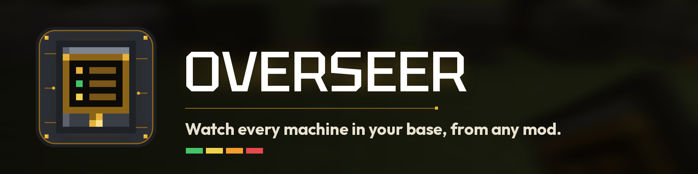
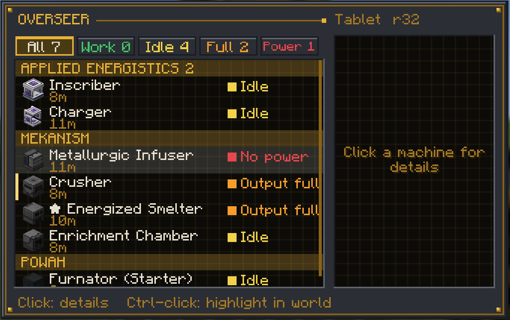
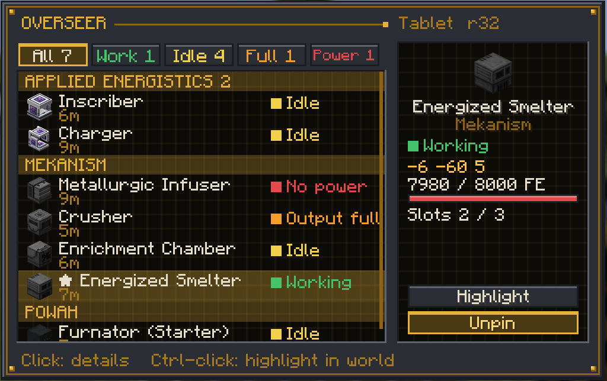
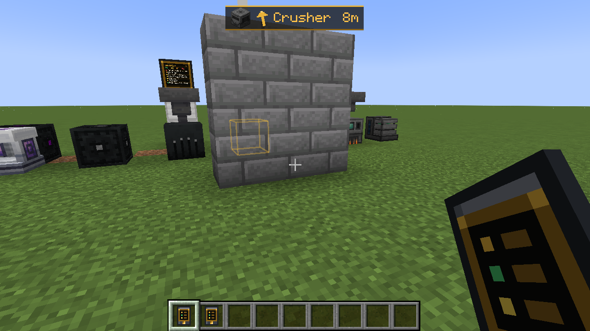
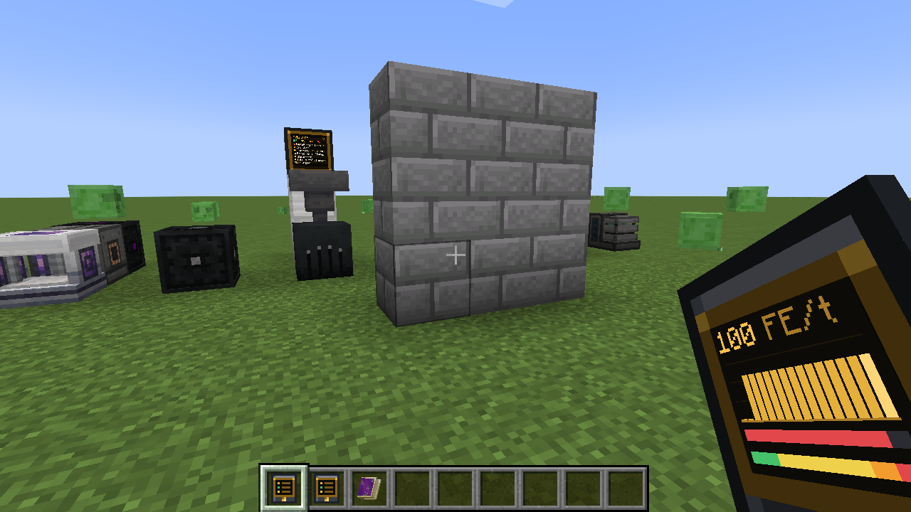
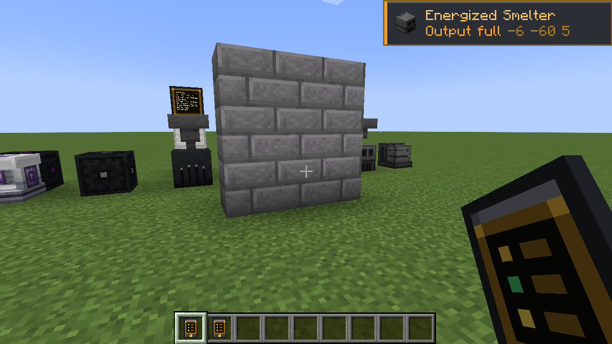
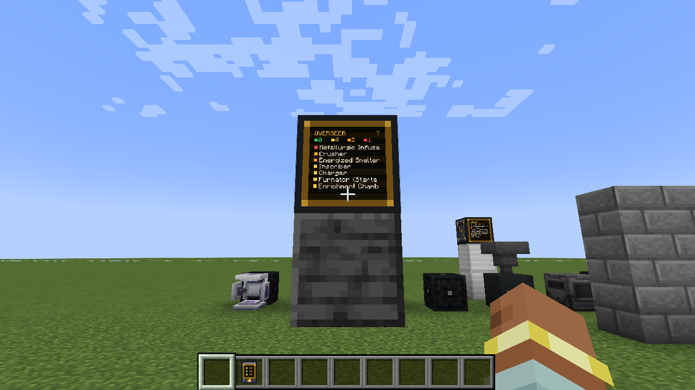
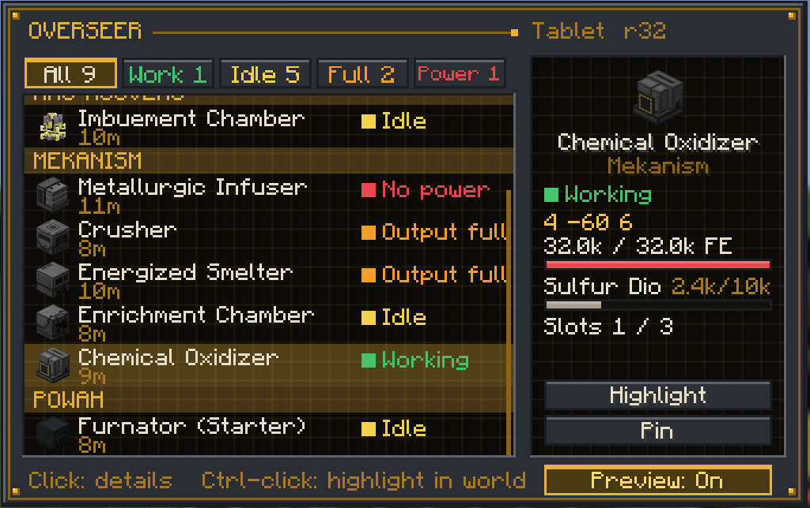

# Overseer

Watch every machine in your base, from any mod. Made for kitchen-sink packs.

NeoForge 1.21.1. No dependencies.

## What it does
- **Overseer Tablet**: use it to list every machine within 32 blocks. Each one shows as **Working**, **Idle**, **Output full** or **No power**, grouped by mod.
- **Click** a machine to see its details: energy, fluid, slots, position, plus Ars Nouveau Source and Mekanism chemicals when those mods are installed.
- **Live preview**: while you hold the tablet its screen shows the power draw of nearby machines (FE/t with a 16-second graph), stored energy and the status mix. Toggle it with the Preview button in the tablet screen.
- **Ctrl-click** a machine to highlight it in the world: a gold outline that shows through walls, a light beam, and a HUD arrow with the distance. It clears when you reach the machine or ctrl-click it again.
- **Sneak-use** a machine with the tablet to pin it. Pinned machines show up from any distance and in any dimension. You get a toast when a pinned machine runs out of power or fills its output.
- **Overseer Screen**: a wall monitor that shows a live status list on its face. Right-click it for the full view.

| Ctrl-click highlight | Live preview |
| --- | --- |
|  |  |

| Pin alert | Overseer Screen |
| --- | --- |
|  |  |

## Recipes
- **Overseer Tablet**: iron / glass pane / iron, redstone / comparator / redstone, iron / gold ingot / iron.
- **Overseer Screen**: 3 iron on top, glass pane / Overseer Tablet / glass pane, gold ingot / redstone block / gold ingot.

## How it reads machines
It works from the standard NeoForge energy, item and fluid capabilities, so it needs no per-mod code:
- No power: the energy buffer is empty, or a furnace has input but no fuel.
- Working: the block shows a lit or active state, or its energy, items or fluids changed in the last few seconds.
- Output full: the machine is idle and a slot or tank is full.
- Create kinetic blocks with an inventory show No power when stalled or overstressed.
- Ars Nouveau machines with no Source show No power.
- Power draw uses Mekanism's own usage figure, and for other mods the drop in stored energy (which reads 0 while cables keep a machine topped up).

Storage blocks such as chests and barrels are skipped. Add blocks to the `overseer:ignored` tag to hide them, or to `overseer:machines` to force them in.

## Config (server)
`scanRadius`, `maxMachines`, `idleSeconds`, `maxItemOnlySlots`, `maxPins`.
